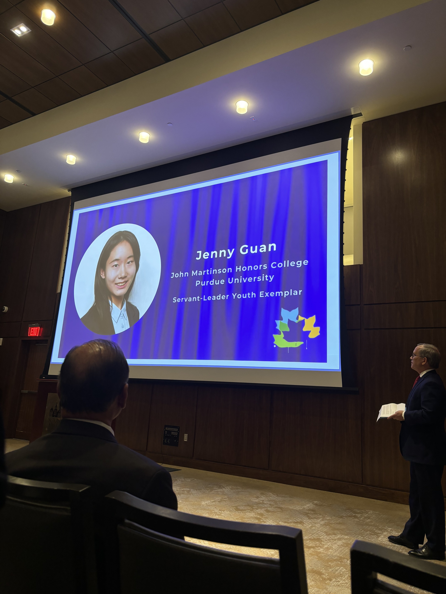

## Leadership & Service Recognition

### Greenleaf Center for Servant Leadership
**Hall of Fame Youth Servant-Leader Exemplar | 2024**

Recognized for contributions to servant leadership and service-oriented leadership development.

  
  
<em>Greenleaf Servant-Leader Hall of Fame, 2024</em>

  
  
<em>Greenleaf Center for Servant Leadership, 2024</em>

### John Martinson Honors College
**Pillars of the Honors College — Second-Year Leadership Honorable Mention | 2025**

Recognized for student leadership.

### DeVos Scholar
**Principled Business Leadership Ambassadors | Purdue University**

Selected to participate in a leadership development program emphasizing principled business leadership.

## Academic Honors

### Purdue University
**Dean's List & Semester Honors | Fall 2023–Spring 2026**

Recognized for academic achievement at Purdue University.

### John Martinson Honors College
**Honors Project Award & Scholarly Project Grant | $1,000**

Received recognition and research support for an undergraduate scholarly project.

---

## Competitions & Team Achievements

### Purdue University
**Quantitative Methods Project Showcase — First Place**

First-place team recognition for a Toyota-related analytics project.

### National Collegiate Table Tennis Association
**Women's Team Regional Champion | 2023–2025**

### National Collegiate Table Tennis Association
**National Top 10 Team & Doubles | 2025**
