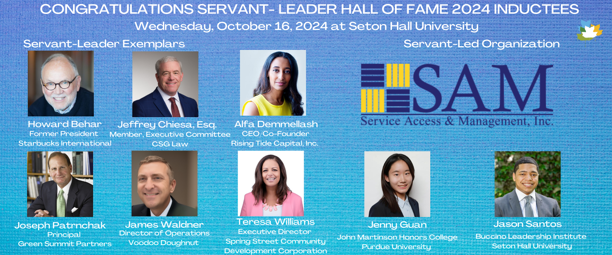
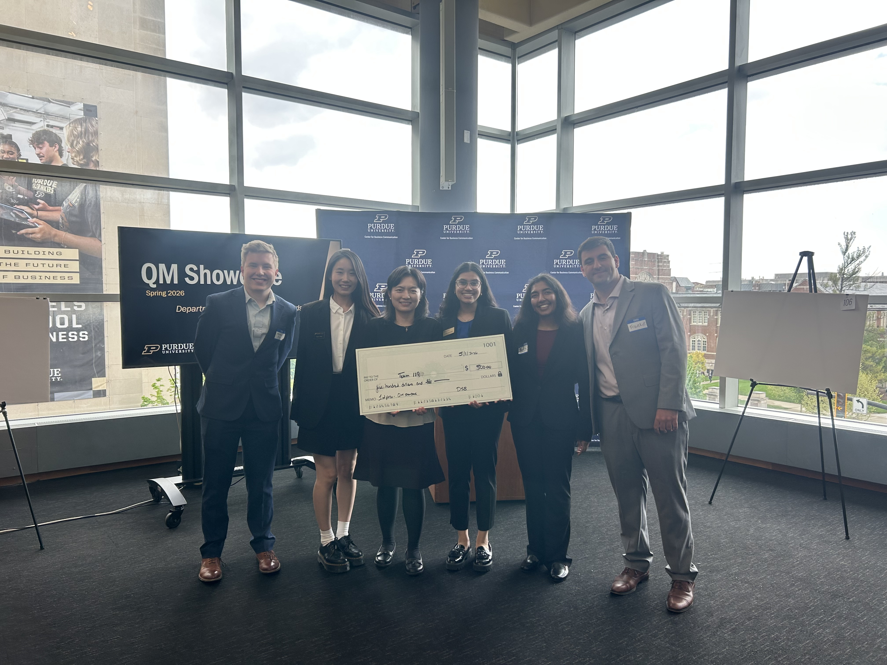
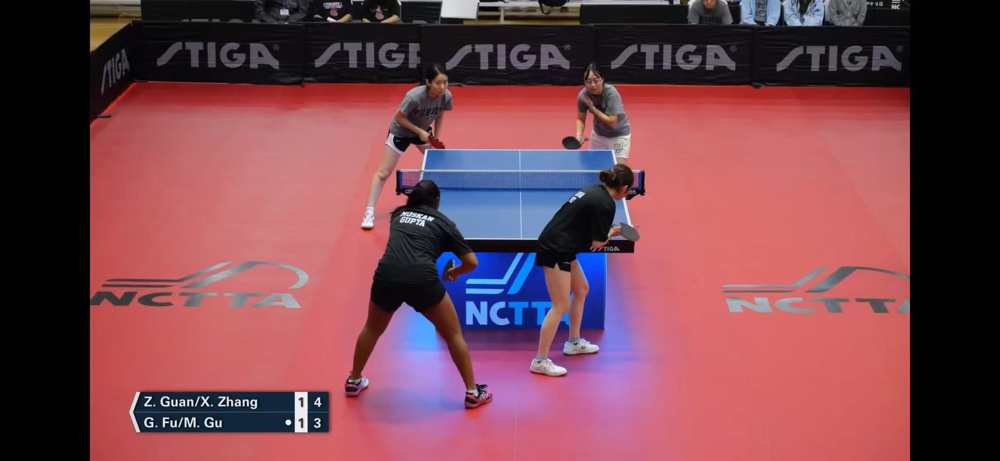
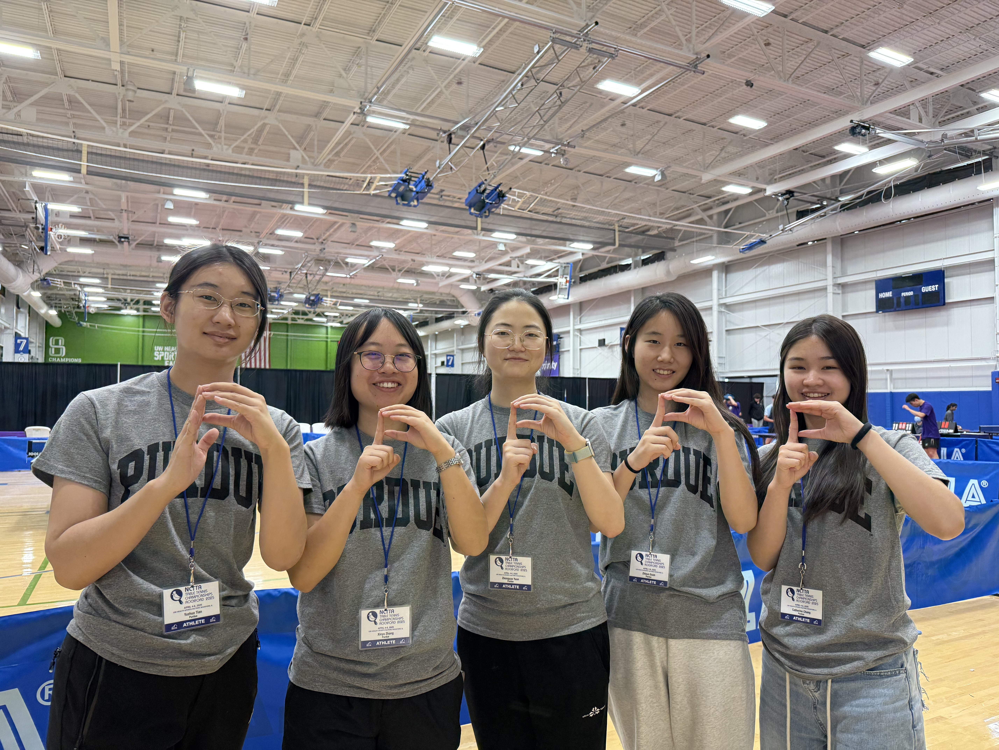
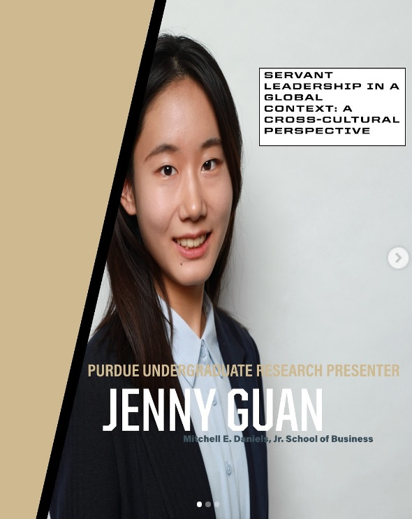
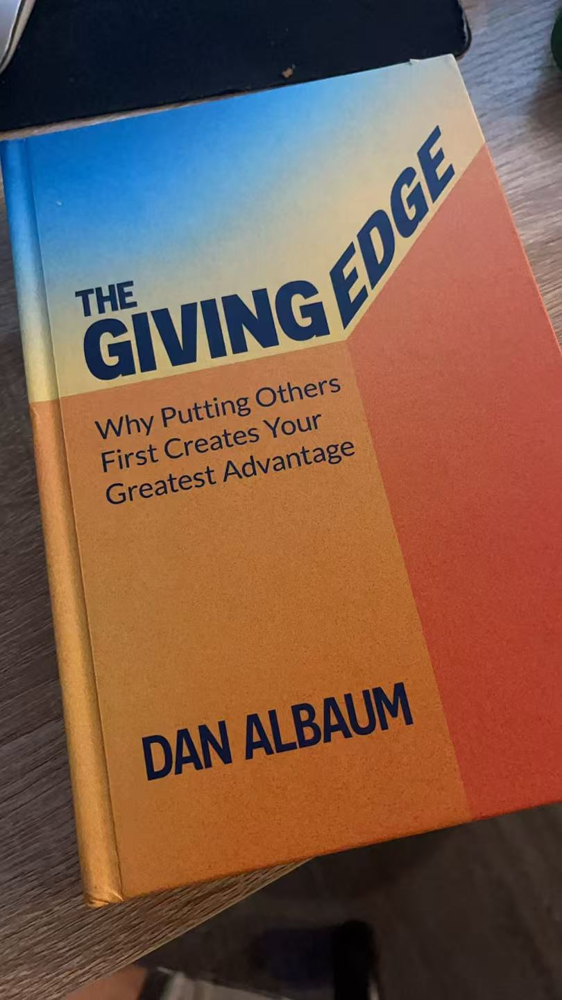
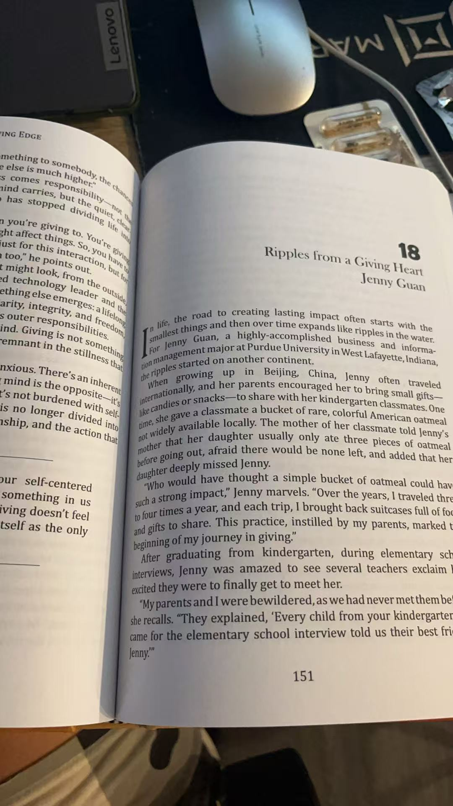

## Leadership & Service Recognition

### Greenleaf Center for Servant Leadership
**Hall of Fame Youth Servant-Leader Exemplar | 2024**

Recognized for contributions to servant leadership and service-oriented leadership development.

  
  
<em>Greenleaf Servant-Leader Hall of Fame, 2024</em>

  
  
<em>Greenleaf Center for Servant Leadership, 2024</em>

### John Martinson Honors College
**Pillars of the Honors College — Second-Year Leadership Honorable Mention | 2025**

Recognized for student leadership.

  
  
<em>John Martinson Honors College, Purdue University | 2025</em>

## Academic Honors

### Purdue University
**Dean's List & Semester Honors | Fall 2023–Spring 2026**

Recognized for academic achievement at Purdue University.

### John Martinson Honors College
**Honors Project Grant**

Received research support for an undergraduate scholarly project.

---

## Competitions & Team Achievements

### Purdue University
**Quantitative Methods Project Showcase — First Place**
First-place team recognition for a quantitative methods project developed in collaboration with Toyota.

  
  

    <em>Quantitative Methods Project Showcase — First Place | Purdue University</em>
  

### National Collegiate Table Tennis Association
**Women's Team Regional Champion | 2023–2025**

### National Collegiate Table Tennis Association
**National Top 10 Team & Doubles | 2025**

  
  

    <em>NCTTA National Championships | 2025</em>
  

  
  

    <em>Purdue University Table Tennis Team | 2025</em>
  

---

## Institutional Recognition & Features

### John Martinson Honors College, Purdue University

**Undergraduate Research Presenter & JMHC Student Spotlight**

Featured by Purdue University's John Martinson Honors College in an official Instagram student spotlight highlighting my undergraduate research, servant leadership scholarship, cross-cultural collaborations, and academic publishing.

  
  

    <em>John Martinson Honors College Undergraduate Research Student Spotlight</em>
  

[View Official Instagram Feature](https://www.instagram.com/p/DXHfHcvgNPc/?img_index=1)

### Purdue University — Undergraduate Student Blog

Featured in a Purdue University undergraduate student blog article highlighting my academic journey, research interests, and leadership experiences.

[Read the University Feature](https://business.purdue.edu/undergraduate/student-experience/blog/posts/building-a-legacy-of-service.php)

### The Giving Edge — Market Impact Press

  

  

Featured in Chapter 18, “Ripples from a Giving Heart,” of <em>The Giving Edge: Why Putting Others First Creates Your Greatest Advantage</em> (Market Impact Press, June 9, 2026). The chapter highlights my personal experiences with generosity and explores how early acts of giving can shape values-based leadership, servant leadership, and a lifelong commitment to serving others.

<strong>ISBN-13:</strong> 979-8995423416

### 2025 Daniels 20 Under 20

Featured in the 2025 Daniels 20 Under 20 student recognition publication by the Daniels School of Business at Purdue University, highlighting my academic journey, leadership initiatives, and contributions to servant leadership through the Leadership Enhancement Organization (LEO).

[Read Feature (PDF)](/files/2025_Daniels_20_Under_20_Jenny_Guan.pdf)
